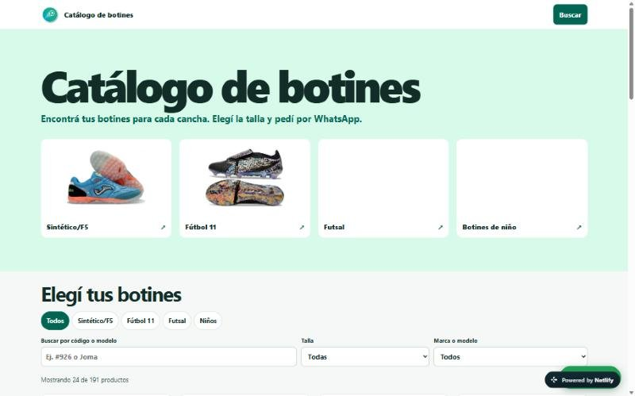

# Catálogo de botines

Catálogo online para una tienda de botines con pedido por WhatsApp.

**Sitio:** https://catalogo-de-botines-ar.netlify.app

## Qué tiene

- 191 productos con filtros por tipo de cancha (sintético/F5, fútbol 11, futsal, niños), talla y marca.
- Búsqueda por código o modelo.
- El cliente toca su talla y el pedido se arma solo en WhatsApp.

## Tecnología

Un solo archivo HTML con CSS y JavaScript. Publicado en Netlify.

---

Hecho por [Federico Momesso](https://github.com/federicomomesso) · FM estudio
